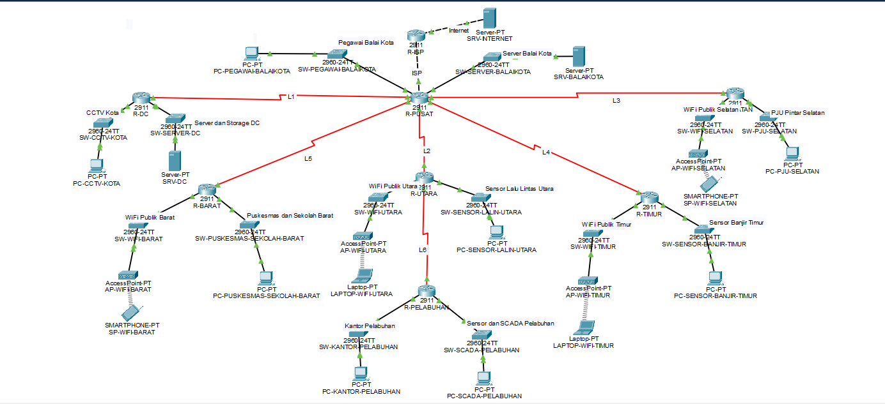

# MidProject Jaringan Komputer - Kelompok 12

## Angota Kelompok

| Nama                         | NRP        |
| ---------------------------- | ---------- |
| Az Zahra Fiddien Al Farabi          | 5027251021 |
| M. Razan Azizi Djauhari | 5027251086 |
| Rheza Pramudita Adi Putra | 5027251090|

## 1. Topologi 


### 1.1 Backbone
Hubungan antar-router mengikuti Gambar 1 pada soal:

| Link | Router atas | Router bawah | Network | Media |
|---|---|---|---|---|
| L1 | R-PUSAT Se0/0/0 (.33) | R-DC Se0/0/0 (.34) | 10.96.241.32/30 | Serial |
| L2 | R-PUSAT Se0/0/1 (.37) | R-UTARA Se0/0/0 (.38) | 10.96.241.36/30 | Serial |
| L3 | R-PUSAT Se0/1/0 (.41) | R-SELATAN Se0/0/0 (.42) | 10.96.241.40/30 | Serial |
| L4 | R-PUSAT Se0/1/1 (.45) | R-TIMUR Se0/0/0 (.46) | 10.96.241.44/30 | Serial |
| L5 | R-PUSAT Se0/2/0 (.49) | R-BARAT Se0/0/0 (.50) | 10.96.241.48/30 | Serial |
| L6 | R-UTARA Se0/0/1 (.53) | R-PELABUHAN Se0/0/0 (.54) | 10.96.241.52/30 | Serial |
| ISP | R-PUSAT Gi0/0 (.49) | R-ISP Gi0/0 (.50) | 203.0.113.48/30 | Copper cross-over |
| Internet | R-ISP Gi0/1 (8.8.8.1) | SRV-INTERNET (8.8.8.8) | 8.8.8.0/24 | Copper cross-over |

R-PUSAT (Balai Kota) menjadi pusat topologi bintang yang terhubung ke R-DC, R-BARAT, R-UTARA, R-TIMUR, dan R-SELATAN. R-PELABUHAN tidak terhubung langsung ke R-PUSAT, melainkan melalui R-UTARA (L6), sesuai Gambar 1.

### 1.2 Desain setiap lokasi

| Router | Port | Switch | Perangkat perwakilan | Media | Network |
|---|---|---|---|---|---|
| R-PUSAT | Gi0/1 | SW-PEGAWAI-BALAIKOTA | PC-PEGAWAI-BALAIKOTA | Kabel | 10.96.224.0/21 |
| R-PUSAT | Gi0/2 | SW-SERVER-BALAIKOTA | SRV-BALAIKOTA | Kabel | 10.96.241.0/27 |
| R-DC | Gi0/0 | SW-CCTV-KOTA | PC-CCTV-KOTA | Kabel | 10.96.96.0/19 |
| R-DC | Gi0/1 | SW-SERVER-DC | SRV-DC | Kabel | 10.96.239.0/24 |
| R-UTARA | Gi0/0 | SW-WIFI-UTARA | AP-WIFI-UTARA + LAPTOP-WIFI-UTARA | Wireless | 10.96.0.0/18 |
| R-UTARA | Gi0/1 | SW-SENSOR-LALIN-UTARA | PC-SENSOR-LALIN-UTARA | Kabel | 10.96.236.0/23 |
| R-PELABUHAN | Gi0/0 | SW-KANTOR-PELABUHAN | PC-KANTOR-PELABUHAN | Kabel | 10.96.240.0/25 |
| R-PELABUHAN | Gi0/1 | SW-SCADA-PELABUHAN | PC-SCADA-PELABUHAN | Kabel | 10.96.160.0/19 |
| R-SELATAN | Gi0/0 | SW-WIFI-SELATAN | AP-WIFI-SELATAN + SP-WIFI-SELATAN | Wireless | 10.96.64.0/19 |
| R-SELATAN | Gi0/1 | SW-PJU-SELATAN | PC-PJU-SELATAN | Kabel | 10.96.240.128/25 |
| R-TIMUR | Gi0/0 | SW-WIFI-TIMUR | AP-WIFI-TIMUR + LAPTOP-WIFI-TIMUR | Wireless | 10.96.128.0/19 |
| R-TIMUR | Gi0/1 | SW-SENSOR-BANJIR-TIMUR | PC-SENSOR-BANJIR-TIMUR | Kabel | 10.96.232.0/22 |
| R-BARAT | Gi0/0 | SW-WIFI-BARAT | AP-WIFI-BARAT + SP-WIFI-BARAT | Wireless | 10.96.192.0/19 |
| R-BARAT | Gi0/1 | SW-PUSKESMAS-SEKOLAH-BARAT | PC-PUSKESMAS-SEKOLAH-BARAT | Kabel | 10.96.238.0/24 |

### 1.3 Pertimbangan dan alasan desain

| Komponen | Pilihan | Alasan |
|---|---|---|
| **Router** | Cisco 2911 untuk semua router | Memiliki 3 port Gigabit bawaan dan 4 slot modul, serta mendukung semua fitur yang dibutuhkan soal: static routing, DHCP, NAT, tunnel GRE, OSPF, dan IPsec (lisensi securityk9). |
| **Penambahan port router** | Modul **HWIC-2T** (2 port serial per modul) | Port bawaan tidak cukup. R-PUSAT membutuhkan 8 interface (5 link backbone, 1 link ISP, 2 LAN), sehingga dipasang 3 modul (eHWIC 0–2). R-UTARA dipasang 2 modul untuk L2, L6, dan L7 (link cadangan soal 7). Router lain cukup 1 modul (eHWIC 0). |
| **Media backbone** | Kabel **serial** | Mewakili link WAN antar wilayah kota yang berjauhan. Sisi DCE ditempatkan di router atas (R-PUSAT untuk L1–L5, R-UTARA untuk L6) dan diberi `clock rate`. |
| **Link ke ISP dan internet** | Kabel **copper cross-over** | R-PUSAT–R-ISP adalah sambungan router ke router, dan R-ISP–SRV-INTERNET adalah router ke server tanpa switch, sehingga menggunakan cross-over. |
| **Media LAN** | Kabel **copper straight-through** | Menghubungkan perangkat berbeda jenis: port Gigabit router → port Gi0/1 switch, lalu port Fa0/1 switch → perangkat. |
| **Switch** | 1 × Cisco 2960 per LAN (14 switch) | Setiap LAN adalah satu broadcast domain tersendiri. Switch menyediakan tempat untuk menambah host hingga jumlah penuh dan dapat dikembangkan bertingkat. |
| **LAN WiFi Publik** (Utara, Selatan, Timur, Barat) | **Access Point** + perangkat **wireless** | Pengguna WiFi publik menggunakan perangkat mobile. Laptop dipasang modul WPC300N, smartphone sudah memiliki WiFi bawaan. Setiap wilayah memakai SSID sendiri: `WiFi-Utara-K12`, `WiFi-Selatan-K12`, `WiFi-Timur-K12`, `WiFi-Barat-K12`. |
| **LAN sensor, CCTV, SCADA, dan PJU** | PC kabel sebagai perwakilan | Perangkat IoT tersebut terpasang tetap sehingga menggunakan kabel. PC dipilih sebagai perwakilan karena dapat menjalankan ping, tracert, dan FTP untuk pengujian. |
| **LAN Pegawai Balai Kota, Kantor Pelabuhan, Puskesmas dan Sekolah** | PC kabel | Mewakili workstation kantor yang bersifat tetap. |
| **LAN Server** | Server dengan **IP statis** | Soal mewajibkan server memakai IP statis. **SRV-BALAIKOTA (10.96.241.10)** menjalankan layanan web. **SRV-DC (10.96.239.10)** menjalankan DNS, DHCP untuk CCTV Kota, FTP, dan email. |
| **Jumlah perangkat per LAN** | 1 perangkat perwakilan | Sesuai ketentuan soal. Perhitungan subnet tetap menggunakan jumlah host penuh. |

### 1.4 Penamaan dan label
- Semua nama bawaan perangkat diganti dengan nama yang menunjukkan lokasinya: `R-<WILAYAH>` untuk router, `SW-<LAN>` untuk switch, `AP-WIFI-<WILAYAH>` untuk access point, `PC-<LAN>`, `LAPTOP-WIFI-<WILAYAH>`, dan `SP-WIFI-<WILAYAH>` untuk perangkat pengguna, serta `SRV-<LOKASI>` untuk server.
- Setiap LAN diberi label berisi nama subnet, Network ID/prefix, dan jumlah host, contoh: `CCTV Kota | 10.96.96.0/19 | 6.000 host`.
- Setiap link backbone diberi label nama link dan network-nya, contoh: `L1 | 10.96.241.32/30`.

### 1.5 Ringkasan perangkat

| Perangkat | Model | Jumlah |
|---|---|---|
| Router | Cisco 2911 | 8 |
| Modul serial | HWIC-2T | 10 |
| Switch | Cisco 2960-24TT | 14 |
| Access Point | AccessPoint-PT | 4 |
| PC | PC-PT | 8 |
| Laptop | Laptop-PT (WPC300N) | 2 |
| Smartphone | Smartphone-PT | 2 |
| Server | Server-PT | 3 |


## 2. Blok Alamat dan Pemilihan Skema

Link spreadsheet tabel: https://docs.google.com/spreadsheets/d/1NvaxmlzC8IM6mpqm_pLIWuHrr4Bjr4hK/edit?usp=sharing&ouid=115783535153531900641&rtpof=true&sd=true

### 2.1 Blok alamat kelompok
Sesuai aturan soal, oktet ke-2 = 8 × nomor kelompok = 8 × 12 = **96**, sehingga blok alamat Kelompok 12 adalah **10.96.0.0**.

Rentang privat yang dipakai adalah **10.0.0.0/8**, karena:
- Oktet ke-2 bernilai 96 hanya mungkin di rentang 10.0.0.0/8. Rentang 172.16.0.0/12 hanya memiliki oktet ke-2 antara 16–31, sedangkan 192.168.0.0/16 oktet ke-2-nya selalu 168.
- Total kebutuhan alamat seluruh subnet adalah **61.760 alamat**, sehingga membutuhkan minimal blok /16. Ukuran ini terlalu besar untuk 192.168.0.0/16.
- Alamat privat tidak dirutekan di internet, sehingga akses ke server 8.8.8.8 dilakukan melalui NAT di R-PUSAT.

### 2.2 Perbandingan VLSM dan CIDR

| Metode | Prefix terkecil yang menampung | Ukuran blok | Pemakaian | Alamat terbuang |
|---|---|---|---|---|
| **VLSM** | 10.96.0.0/16 | 65.536 | **94,24%** | 3.776 |
| CIDR | 10.96.0.0/15 | 131.072 | 47,12% | 69.312 |

### 2.3 Alasan memilih VLSM
Kelompok kami memilih **VLSM** untuk diimplementasikan di Packet Tracer, dengan alasan:

1. **Paling efisien dalam pemakaian alamat.**
   VLSM memotong blok sesuai kebutuhan setiap subnet dan menyusunnya berurutan dari yang terbesar, sehingga sisa alamat hanya berasal dari pembulatan ke 2ⁿ. Hasilnya 94,24% alamat terpakai dan seluruh jaringan kota muat dalam satu blok **/16**. Sebaliknya, CIDR mengharuskan setiap router memiliki satu blok supernet berukuran 2ⁿ, misalnya subnet /19 dan /25 di satu router harus digabung menjadi /18. Akibatnya banyak ruang kosong dan total kebutuhan naik menjadi /15 dengan pemakaian hanya 47,12% (selisih 47,12 poin).

2. **Paling konsisten dengan lembar jawaban UTS.**
   Urutan alokasi VLSM di lembar UTS kelompok sudah benar (subnet terbesar dialokasikan lebih dulu) dan tujuh subnet pertama tidak perlu diubah. Kesalahan hanya terjadi pada network ID mulai subnet ke-8 dan sudah dicatat di tabel revisi. Dengan VLSM, perubahan dari UTS paling sedikit sehingga implementasi tetap konsisten dengan perhitungan.

3. **Ruang alamat tersisa tetap rapi untuk pengembangan.**
   Seluruh subnet berada di 10.96.0.0 – 10.96.241.63, dan link tambahan Mid-Project (L7 dan Tunnel0) dapat ditempatkan langsung setelah link L6 tanpa menggeser subnet lain.

**Konsekuensi yang kami terima:** karena alamat LAN milik satu router tidak berdekatan (contoh: CCTV Kota 10.96.96.0/19 dan Server dan Storage DC 10.96.239.0/24, keduanya di R-DC), rute tidak dapat diringkas per router. R-PUSAT memerlukan satu static route untuk setiap LAN di bawahnya (dua rute per router).

## 3. Konfigurasi Dasar dan IP Address Interface

Sebelum routing dikonfigurasi, setiap router diberi **hostname** dan **alamat IP** pada setiap port yang dipakai, lalu port dinyalakan. Tahap ini menjadi dasar untuk soal 3: router hanya mengenal jaringan yang terhubung langsung (*connected*), sehingga link antar-router harus hidup lebih dulu sebelum static route dipasang.

### 3.1 Aturan pengalamatan
- **Gateway LAN** = host pertama setiap subnet VLSM (contoh: CCTV Kota 10.96.96.0/19 → gateway 10.96.96.1).
- **Link antar-router /30**: router atas memakai host pertama, router bawah memakai host kedua (contoh: L1 10.96.241.32/30 → R-PUSAT .33, R-DC .34).
- **Sisi DCE** kabel serial (R-PUSAT untuk L1–L5, R-UTARA untuk L6) diberi `clock rate 2000000`.
- **Link ISP** memakai IP publik simulasi 203.0.113.48/30 (R-PUSAT .49, R-ISP .50).

### 3.2 Arti perintah

| Perintah | Fungsi |
|---|---|
| `enable` | Masuk mode privileged (`Router#`) |
| `configure terminal` | Masuk mode konfigurasi global (`Router(config)#`) |
| `hostname R-PUSAT` | Mengganti nama router |
| `no ip domain-lookup` | Mencegah CLI menunggu lama saat salah ketik perintah |
| `interface …` | Memilih port yang dikonfigurasi |
| `description …` | Catatan fungsi port |
| `ip address <IP> <mask>` | Memberi alamat IP pada port |
| `clock rate 2000000` | Sinyal clock pada sisi DCE kabel serial |
| `no shutdown` | Menyalakan port (port router Cisco mati secara default) |
| `write memory` | Menyimpan konfigurasi ke NVRAM |

### 3.3 Konfigurasi setiap router

**R-PUSAT**
```
enable
configure terminal
hostname R-PUSAT
no ip domain-lookup
interface GigabitEthernet0/0
 description Link ke R-ISP
 ip address 203.0.113.49 255.255.255.252
 no shutdown
interface GigabitEthernet0/1
 description LAN Pegawai Balai Kota
 ip address 10.96.224.1 255.255.248.0
 no shutdown
interface GigabitEthernet0/2
 description LAN Server Balai Kota
 ip address 10.96.241.1 255.255.255.224
 no shutdown
interface Serial0/0/0
 description L1 ke R-DC
 ip address 10.96.241.33 255.255.255.252
 clock rate 2000000
 no shutdown
interface Serial0/0/1
 description L2 ke R-UTARA
 ip address 10.96.241.37 255.255.255.252
 clock rate 2000000
 no shutdown
interface Serial0/1/0
 description L3 ke R-SELATAN
 ip address 10.96.241.41 255.255.255.252
 clock rate 2000000
 no shutdown
interface Serial0/1/1
 description L4 ke R-TIMUR
 ip address 10.96.241.45 255.255.255.252
 clock rate 2000000
 no shutdown
interface Serial0/2/0
 description L5 ke R-BARAT
 ip address 10.96.241.49 255.255.255.252
 clock rate 2000000
 no shutdown
end
write memory
```

**R-ISP**
```
enable
configure terminal
hostname R-ISP
no ip domain-lookup
interface GigabitEthernet0/0
 description Link ke R-PUSAT
 ip address 203.0.113.50 255.255.255.252
 no shutdown
interface GigabitEthernet0/1
 description Gateway server internet 8.8.8.8
 ip address 8.8.8.1 255.255.255.0
 no shutdown
end
write memory
```

**R-DC**
```
enable
configure terminal
hostname R-DC
no ip domain-lookup
interface GigabitEthernet0/0
 description LAN CCTV Kota
 ip address 10.96.96.1 255.255.224.0
 no shutdown
interface GigabitEthernet0/1
 description LAN Server dan Storage DC
 ip address 10.96.239.1 255.255.255.0
 no shutdown
interface Serial0/0/0
 description L1 ke R-PUSAT
 ip address 10.96.241.34 255.255.255.252
 no shutdown
end
write memory
```

**R-UTARA**
```
enable
configure terminal
hostname R-UTARA
no ip domain-lookup
interface GigabitEthernet0/0
 description LAN WiFi Publik Utara
 ip address 10.96.0.1 255.255.192.0
 no shutdown
interface GigabitEthernet0/1
 description LAN Sensor Lalu Lintas Utara
 ip address 10.96.236.1 255.255.254.0
 no shutdown
interface Serial0/0/0
 description L2 ke R-PUSAT
 ip address 10.96.241.38 255.255.255.252
 no shutdown
interface Serial0/0/1
 description L6 ke R-PELABUHAN
 ip address 10.96.241.53 255.255.255.252
 clock rate 2000000
 no shutdown
end
write memory
```

**R-PELABUHAN**
```
enable
configure terminal
hostname R-PELABUHAN
no ip domain-lookup
interface GigabitEthernet0/0
 description LAN Kantor Pelabuhan
 ip address 10.96.240.1 255.255.255.128
 no shutdown
interface GigabitEthernet0/1
 description LAN Sensor dan SCADA Pelabuhan
 ip address 10.96.160.1 255.255.224.0
 no shutdown
interface Serial0/0/0
 description L6 ke R-UTARA
 ip address 10.96.241.54 255.255.255.252
 no shutdown
end
write memory
```

**R-SELATAN**
```
enable
configure terminal
hostname R-SELATAN
no ip domain-lookup
interface GigabitEthernet0/0
 description LAN WiFi Publik Selatan
 ip address 10.96.64.1 255.255.224.0
 no shutdown
interface GigabitEthernet0/1
 description LAN PJU Pintar Selatan
 ip address 10.96.240.129 255.255.255.128
 no shutdown
interface Serial0/0/0
 description L3 ke R-PUSAT
 ip address 10.96.241.42 255.255.255.252
 no shutdown
end
write memory
```

**R-TIMUR**
```
enable
configure terminal
hostname R-TIMUR
no ip domain-lookup
interface GigabitEthernet0/0
 description LAN WiFi Publik Timur
 ip address 10.96.128.1 255.255.224.0
 no shutdown
interface GigabitEthernet0/1
 description LAN Sensor Banjir Timur
 ip address 10.96.232.1 255.255.252.0
 no shutdown
interface Serial0/0/0
 description L4 ke R-PUSAT
 ip address 10.96.241.46 255.255.255.252
 no shutdown
end
write memory
```

**R-BARAT**
```
enable
configure terminal
hostname R-BARAT
no ip domain-lookup
interface GigabitEthernet0/0
 description LAN WiFi Publik Barat
 ip address 10.96.192.1 255.255.224.0
 no shutdown
interface GigabitEthernet0/1
 description LAN Puskesmas dan Sekolah Barat
 ip address 10.96.238.1 255.255.255.0
 no shutdown
interface Serial0/0/0
 description L5 ke R-PUSAT
 ip address 10.96.241.50 255.255.255.252
 no shutdown
end
write memory
```

### 3.4 Pengujian

Setiap link diuji dengan ping dari router atas ke IP router bawah:

| Dari | Perintah | IP milik | Link | Hasil |
|---|---|---|---|---|
| R-PUSAT | `ping 10.96.241.34` | R-DC Serial0/0/0 | L1 | |
| R-PUSAT | `ping 10.96.241.38` | R-UTARA Serial0/0/0 | L2 | `!!!!!` 100% |
| R-PUSAT | `ping 10.96.241.42` | R-SELATAN Serial0/0/0 | L3 | `!!!!!` 100% |
| R-PUSAT | `ping 10.96.241.46` | R-TIMUR Serial0/0/0 | L4 | `!!!!!` 100% |
| R-PUSAT | `ping 10.96.241.50` | R-BARAT Serial0/0/0 | L5 | `!!!!!` 100% |
| R-PUSAT | `ping 203.0.113.50` | R-ISP GigabitEthernet0/0 | ISP | `.!!!!` 80% |
| R-UTARA | `ping 10.96.241.54` | R-PELABUHAN Serial0/0/0 | L6 | |


